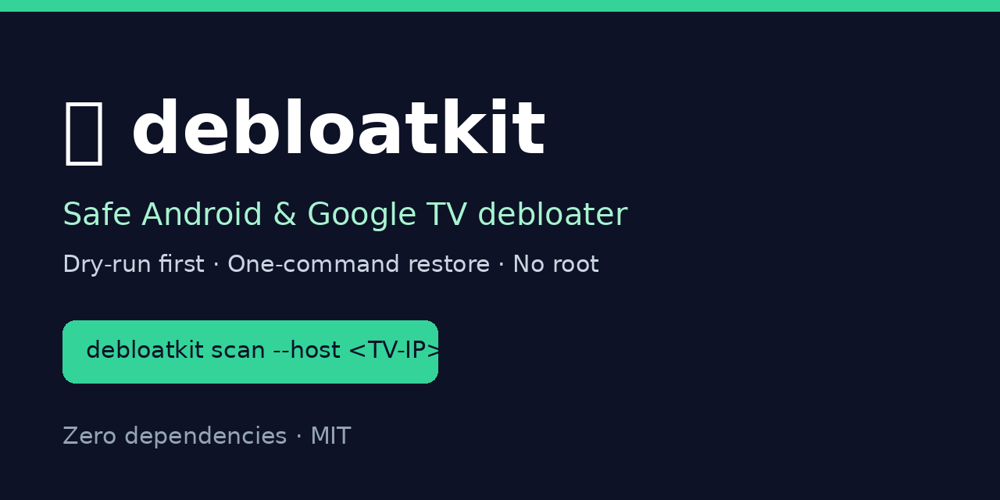

# 🧹 debloatkit — Safe Android & Google TV Debloater

[](https://github.com/BidyutRoy2/debloatkit/actions/workflows/ci.yml)
[](LICENSE)
[](https://www.python.org/)
[](pyproject.toml)

**Make any Android TV, Google TV, or Android phone feel like an Apple TV home screen — without root, without deleting anything permanently, and without touching a single system app that matters.**

debloatkit connects to your device over Wi-Fi with ADB, shows you exactly what it would disable, and only changes something after you review the plan. Every change is reversible with one command.



## ⚡ Quickstart

```bash
pip install debloatkit

# 1. On your TV/phone: Settings → enable Developer options → enable Wireless debugging
#    (on older Android: Developer options → USB debugging, then adb connect works the same way)
# 2. Find your device IP: TV Settings → Network → your Wi-Fi → IP address

# 3. See the plan first — this changes NOTHING:
debloatkit scan --host 192.168.1.50 --report report.html

# 4. Apply it (writes backup.json first, then disables):
debloatkit apply --host 192.168.1.50 --backup backup.json --yes

# 5. Changed your mind? One command puts everything back:
debloatkit restore --host 192.168.1.50 --backup backup.json --yes
```

No account, no cloud, no telemetry. Your device list never leaves your machine.

👉 **Try the interactive demo first — no device needed:** open [`preview/index.html`](preview/index.html) in a browser to see a sample report, or read the [getting-started guide](docs/getting-started.md).

## Why debloatkit? (and how it differs)

| | debloatkit | Typical debloat scripts | Factory reset |
|---|---|---|---|
| Needs root? | No — ADB only | Usually no | No |
| Dry-run plan before any change? | ✅ Always | ❌ Rarely | — |
| Refuses to touch critical system apps? | ✅ Hard-coded blocklist | ❌ You are the blocklist | — |
| One-command restore? | ✅ `restore --backup` | ❌ Manual re-enable | ✅ But wipes everything |
| HTML report you can read? | ✅ Dark-mode aware | ❌ Terminal output only | — |
| Unknown packages auto-removed? | ❌ Never — reported only | ⚠️ Sometimes | — |
| Dependencies | Zero | Varies | — |

## How safety works

1. **Scan first, always.** `scan` prints a Markdown plan and can write an HTML report. Nothing changes.
2. **A never-touch list is enforced in code.** Launcher, System UI, Play services, Bluetooth, Wi-Fi, and the TV launcher itself cannot be disabled — even if you ask. See [`docs/safety.md`](docs/safety.md).
3. **Disable, don't uninstall.** System apps are disabled with `pm disable-user`, which is fully reversible. User apps are the only ones ever uninstalled, and only if you ask for that mode explicitly.
4. **Backup is mandatory.** `apply` refuses to run without a `--backup` path, so a restore file exists before the first change.
5. **Unknown = untouched.** Any package not in the curated database is reported, never auto-disabled. OEMs rename packages between models — guessing is how devices break.

## Profiles

| Profile | What it does | Best for |
|---|---|---|
| `tv-minimal` (default) | Disables safe streaming preloads only | Most TVs — the Apple-TV-clean home |
| `tv-balanced` | Safe + caution items (voice/cast pieces) | TVs where you don't use voice or cast |
| `phone-minimal` | Safe third-party preloads only | Phones & tablets |
| `aggressive` | Safe + caution, no prompts | Experienced users only |

```bash
debloatkit profiles   # list all profiles with descriptions
```

## Commands

```bash
debloatkit scan --host <IP> [--profile tv-minimal] [--report report.html] [--json plan.json]
debloatkit apply --host <IP> --backup backup.json [--profile tv-minimal] --yes
debloatkit restore --host <IP> --backup backup.json --yes
debloatkit inventory --host <IP>   # plain list of installed packages
```

## Examples

See [`examples/`](examples/) for a sample device inventory, a sample backup file, and a sample report. The [package database guide](docs/package-database.md) explains every risk level and how to propose a new entry.

## Frequently asked questions

### Is debloating my TV safe?
Disabling a preloaded streaming app is safe — you can reinstall it from the Play Store any time. Disabling system services is where things break, which is why debloatkit's never-touch list is enforced in code, not just documented. Read [`docs/safety.md`](docs/safety.md) before your first `apply`.

### Will this void my warranty or need root?
No. ADB device-owner commands like `pm disable-user` are standard Android tooling, no root required, and everything is reversible with `restore`.

### What if my TV stops working after debloating?
Run `debloatkit restore --backup backup.json --yes` — it re-enables exactly what was disabled. If ADB itself is unreachable, a factory reset from the TV's recovery menu also restores everything (that's the last resort, not the plan).

### Does debloatkit work on phones too?
Yes — `phone-minimal` targets third-party preloads on phones and tablets. The never-touch list (telephony, Bluetooth, Play services) applies everywhere.

### Why is a package listed as "unknown"?
Your OEM ships a package name not in our curated database. That's deliberate caution, not a gap to work around: open an issue with the package name and your device model and we'll classify it properly.

### How is this different from universal debloat scripts?
Those scripts run long `pm uninstall` lists with no plan, no report, and no restore file. debloatkit inverts that: plan → review → backup → apply → one-command restore.

## Development

```bash
python -m unittest discover -s tests -t .   # 14 tests, zero dependencies
```

See [CONTRIBUTING.md](CONTRIBUTING.md) for how to propose package-database entries.

## License

MIT — see [LICENSE](LICENSE).
